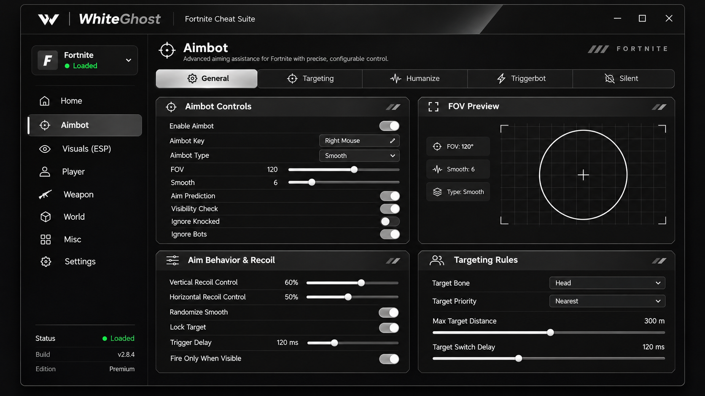

# 👻 WhiteGhost Cheats

**Monochrome UI · Precise Aiming · Stealth Focused · Advanced ESP**

**WhiteGhost** represents the perfect balance between absolute performance and visual elegance. Designed with an ultra-sleek, dark monochrome interface, WhiteGhost provides a distraction-free environment for configuring your Fortnite enhancement tools. It's not just about looking good; it's about providing the most precise, stealth-focused features available on the market. From the moment you open the panel, you'll experience a level of polish and control that sets a new standard for battle royale utilities.

📑 <b>Table of Contents</b>

- [Quick Start](#-quick-start)
- [Requirements](#%EF%B8%8F-requirements)
- [Deep Dive: Key Features](#-key-features)
- [Module Overview](#-module-overview)
- [Why Choose WhiteGhost](#-why-choose-whiteghost)
- [Why Use It](#-why-use-it)
- [FAQ](#-faq)
- [SEO Keywords](#-seo-keywords)

## ⚡ Quick Start

1. Download the official archive from the black button above.
2. Extract the files to your secure utility directory.
3. Run the WhiteGhost executable as Administrator.
4. Start Fortnite and wait for the lobby.
5. Press **INSERT** to bring up the beautiful white-on-black interface.

## 🖥️ Requirements

| Component | Requirement |
|---|---|
| OS | Windows 10 / 11, 64-bit |
| RAM | 8 GB or higher |
| Storage | 200 MB free |
| Privileges | Administrator |

## ✨ Deep Dive: Key Features

### 🎯 Aiming Assistance
- **Precision Targeting**: Locks onto specific bones (Head, Neck, Chest) with pinpoint accuracy.
- **FOV Customization**: Adjustable Field of View (FOV) circle to dictate exactly when the aimbot activates.
- **Visibility Check**: Ensures you only target enemies that are clear and visible.
- **Smoothness Control**: Fine-tune the aim speed to match your natural mouse movement.

### ⚙️ Configuration & Humanization
- **Trigger Delay**: Adds a realistic delay before firing (e.g., 120ms) to avoid suspicion.
- **Auto Switch Target**: Instantly switch to the next closest enemy after a takedown.
- **Ignore Knocked**: Focuses aim only on standing, active threats.
- **Recoil Control System**: Automatically compensates for vertical and horizontal recoil patterns.

### 👁️ Visuals (ESP)
- **Player Bounding Boxes**: Customizable 2D/3D boxes for enemy locations.
- **Loot Radar**: Highlights the best weapons and items in your vicinity.
- **Skeleton Glow**: Tracks player movements through walls.

## 📋 Module Overview

| Module | What it does | Hotkey |
|---|---|---|
| Aimbot Controls | Main aim settings and FOV | F1 |
| Targeting Rules | Defines bone, priority, distance | F2 |
| Humanize | Recoil, delay, randomization | F3 |
| Triggerbot | Auto-fire when target is acquired | F4 |
| Silent Aim | Subtle aim adjustments | F5 |
| Visuals (ESP) | Player and loot highlighting | F6 |
| Settings | Save and load configurations | INSERT |

## 🚀 Why Choose WhiteGhost

✅ **Elegant UI**: A distraction-free, monochrome interface designed for easy navigation.
✅ **Undetected Execution**: Built from the ground up to bypass detection algorithms.
✅ **Precision First**: Aiming systems calibrated for competitive play.
✅ **Max Performance**: Zero performance impact on your game.

## 💡 Why Use It

🎮 **Stealth & Style**: Experience premium cheats without the ugly, cluttered UI.
🔍 **Total Awareness**: Use ESP to read the map and enemy positions perfectly.
🧭 **Consistent Output**: Humanized settings keep your gameplay looking natural.
⚡ **Instant Access**: Intuitive hotkeys for mid-combat changes.

## ❓ FAQ

**Do I need to run it as Administrator?**
Yes — admin rights are required.

**Will antivirus flag it?**
Some heuristic scanners may flag it. Add the directory to your exclusions.

**Does it work on Windows 11?**
Yes — Windows 11 is fully supported.

**How do I update the application?**
Download the latest build from the button above.

**Can I customize the UI color?**
The core layout is monochrome, but accents can be changed in the settings file.

## 🔎 SEO Keywords

WhiteGhost Cheats, cheats for WhiteGhost, WhiteGhost scripts, WhiteGhost cheat panel, WhiteGhost aimbot, WhiteGhost ESP, WhiteGhost triggerbot, WhiteGhost hacks, WhiteGhost visual overlay, WhiteGhost smooth aim, WhiteGhost radar hack, WhiteGhost player tracker, WhiteGhost Windows tool, WhiteGhost admin panel, WhiteGhost aim assist, WhiteGhost loot ESP, WhiteGhost combat overlay, WhiteGhost undetected, WhiteGhost monochrome UI

## ⚠️ Disclaimer

Use of this tool is governed by the rules of the game, the server and the platform. The author makes no claims about safety, ban immunity or official support. Use at your own risk.
